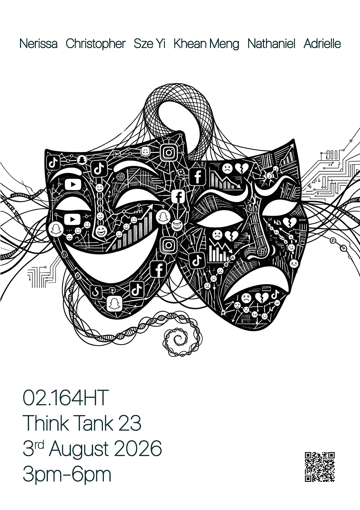

# Stage displays for SUTD Dramaturgy

For the final performance in SUTD 02.164HT Dramaturgy, taught by Prof Nien, the stage technology project explored two kinds of cues. A button press fires neurons in a spinning halftone brain. A show track or a manual cue moves a projected clock through a night compressed into the length of the performance. The repository was previously called `dramaturgh`.



## Rehearse in a browser

Start a local server with Python 3 from the repository root.

```sh
python3 -m http.server 8000
```

| Display | What to try |
| --- | --- |
| [CORTEX·01](http://localhost:8000/BrainButtonInterface/) | Click the brain or press Space to fire a visual pulse. The browser can rehearse the effect without the physical button. |
| [Night clock](http://localhost:8000/SoundControlTimer/) | In manual mode, press Space to advance one hour. In track mode, load audio and scrub it to see the clock move between 23:00 and 07:00. Press H to hide the controls for projection. |
| [Timecode deck](http://localhost:8000/SoundControlTimer/timecode-deck.html) | Inspect the separate show-control study with its camera feed, timecode, and cue rail. Camera access requires browser permission. |

## What drives each display

The [brain page](BrainButtonInterface/index.html) draws the brain and activity trace on HTML canvases. In hardware mode the [ESP32 sketch](BrainButtonInterface/hardware/cortex_button_esp32.ino) debounces the button, counts presses, and uses FastLED to send pulses along a WS2812B strip. The pulse shifts from white towards red as the count rises. The device serves the count over Wi-Fi at `/counter`, and the browser polls it to synchronise the projection.

For a connected rehearsal, serve the page over HTTP on the same network as the ESP32. Enter the board's address from the Serial Monitor. An HTTPS page cannot poll the device's plain HTTP address in this setup. The [hardware guide](BrainButtonInterface/README.md) covers wiring, firmware, and network setup.

The [night clock](SoundControlTimer/index.html) reads the loaded audio's playback position. Pausing the track holds the clock at the same point. In manual mode it holds after each cue. The operator can also show a camera feed, black out the display with S, or restart with R. The [timecode deck source](SoundControlTimer/timecode-deck.html) runs independently. All three pages contain their own JavaScript and CSS and can run without a frontend build.

The performance artwork also includes [drowning](DRAMA_drowning.png), [tunnel](DRAMA_tunnel.png), and [coded human](DRAMA_codedhuman.png) concept stills, plus a [black-and-white halftone video test](A_black_and_white_halftone_vid.mp4).
